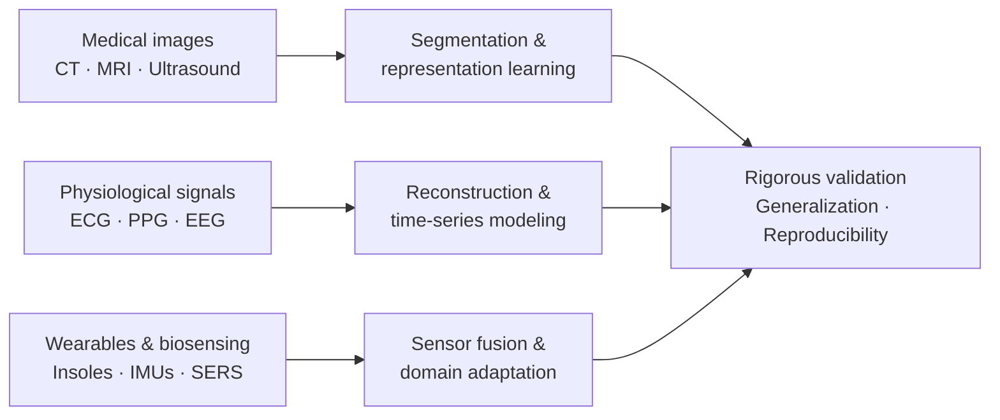

<h1 align="center">Sakib Mahmud</h1>

  <strong>Research Associate · Biomedical AI & Translational Bioengineering</strong> 
  Department of Electrical Engineering · Qatar University · Doha, Qatar

  <a href="https://scholar.google.com/citations?user=jFVg8REAAAAJ">Google Scholar</a> ·
  <a href="https://orcid.org/0000-0002-4599-2192">ORCID</a> ·
  <a href="https://www.scopus.com/authid/detail.uri?authorId=57211999810">Scopus</a> ·
  <a href="https://www.researchgate.net/profile/Sakib-Mahmud-7">ResearchGate</a> ·
  <a href="https://www.linkedin.com/in/sakib1263/">LinkedIn</a> ·
  <a href="https://sakib1263.github.io/Sakib1263/">Website</a> ·
  <a href="mailto:sakib.mahmud@qu.edu.qa">Email</a>

  <em>Connecting biomedical data, robust machine learning, and engineering to advance reproducible healthcare research.</em>

---

**Salam, and welcome.** I am a bioengineering researcher with a BSc (Hons.) and MSc in Electrical Engineering from Qatar University. My work brings together **medical image computing, physiological signal processing, wearable sensing, biospectroscopy, and computational biomechanics**.

I develop and evaluate computational methods for heterogeneous biomedical data, with particular interests in **multimodal learning, foundation-model adaptation, domain generalization, and rigorous validation**. My research spans data and experimental pipeline development, model design, clinical collaborations, and open research dissemination.

  <a href="#research-focus">Research</a> &nbsp;·&nbsp;
  <a href="#selected-publications">Publications</a> &nbsp;·&nbsp;
  <a href="#research-software">Code</a> &nbsp;·&nbsp;
  <a href="#open-datasets">Datasets</a> &nbsp;·&nbsp;
  <a href="#github-activity">Activity</a> &nbsp;·&nbsp;
  <a href="#contact-and-collaboration">Contact</a>

## Research at a glance

| Journal articles | Q1 journal articles | First-author journal articles | Funded research projects |
|:---:|:---:|:---:|:---:|
| **57** | **49** | **17** | **11** |

Publication and project counts reflect my 2026 academic records; journal quartiles are reported as classified in those records.

## Research focus

| Theme | Research questions and approaches |
|:---|:---|
| **Medical imaging & computational oncology** | CT/MRI/ultrasound analysis, tumor and organ segmentation, clinical–imaging integration, multimodal evidence fusion, and foundation-model adaptation. |
| **Physiological AI & digital health** | ECG/PPG/EEG and Doppler/radar analysis, signal restoration, continuous waveform reconstruction, and noninvasive monitoring. |
| **Wearables & computational biomechanics** | Smart-insole and kinematic sensing, 3D ground-reaction force/moment and center-of-pressure estimation, and subject-generalizable models. |
| **Biosensing & spectroscopic diagnostics** | SERS/Raman-based microbial analysis, device-to-device spectral standardization, and robust cross-domain recognition. |

<strong>Research map — data modalities, methods, and validation priorities</strong>

This is a map of recurring research methods and priorities, not a single deployed clinical system.

### Current research directions

- **Multiphase liver CT:** liver-guided segmentation and complementary-phase evidence fusion for robust liver-tumor analysis.
- **Multimodal diabetic-foot assessment:** anatomical alignment and fusion of RGB and thermal images for clinically relevant evaluation.
- **Portable 3D biomechanics:** integrating smart-insole measurements and movement kinematics for force, moment, and center-of-pressure estimation.
- **Cross-device microbial spectroscopy:** SERS standardization and generalizable classification across acquisition conditions.

## Selected publications

Representative contributions across medical imaging, biomedical sensing, and robust AI are listed below. For a full, up-to-date publication record, see [Google Scholar](https://scholar.google.com/citations?user=jFVg8REAAAAJ) or [Scopus](https://www.scopus.com/authid/detail.uri?authorId=57211999810).

### Medical imaging & clinical AI

| Year | Publication | Journal |
|:---:|:---|:---|
| 2026 | [Enhancing kidney stone segmentation in computed tomography images through successive scope reduction and intra-framework feature transfer](https://doi.org/10.1016/j.bspc.2026.109894) | *Biomedical Signal Processing and Control* |
| 2024 | [Automated grading of prenatal hydronephrosis severity from segmented kidney ultrasounds using deep learning](https://doi.org/10.1016/j.eswa.2024.124594) | *Expert Systems with Applications* |
| 2023 | [Kidney cancer diagnosis and surgery selection by machine learning from CT scans combined with clinical metadata](https://doi.org/10.3390/cancers15123189) | *Cancers* |

### Wearable intelligence & physiological computing

| Year | Publication | Journal |
|:---:|:---|:---|
| 2025 | [3D foot kinetics estimation from distributed vGRF from smart insoles via 1D domain transformation](https://doi.org/10.1109/JBHI.2025.3605296) | *IEEE Journal of Biomedical and Health Informatics* |
| 2024 | [Restoration of magnetohydrodynamic-corrupted 12-lead ECG to enhance cardiac monitoring during MRI](https://doi.org/10.1016/j.engappai.2024.108483) | *Engineering Applications of Artificial Intelligence* |
| 2023 | [NABNet: Robust prediction of blood-pressure components from reconstructed arterial blood-pressure waveforms](https://doi.org/10.1016/j.bspc.2022.104247) | *Biomedical Signal Processing and Control* |

### Biosensing & cross-domain diagnostics

| Year | Publication | Journal |
|:---:|:---|:---|
| 2026 | [Machine learning-enabled label-free SERS for microbial sensing: Toward robust, generalizable, and deployable workflows](https://doi.org/10.1016/j.talanta.2026.130241) | *Talanta* · Review |
| 2026 | [Deep learning-based cross-device standardization of SERS for enhanced bacterial recognition](https://doi.org/10.1016/j.saa.2025.126931) | *Spectrochimica Acta Part A* |
| 2026 | [SERS on analyte-enriched blood for rapid, culture-free sepsis recognition and pathogen identification with super-operational neural networks](https://doi.org/10.1016/j.talanta.2025.129332) | *Talanta* |

<strong>Additional selected publications</strong>

- **2024** — [Wearable wrist-to-finger photoplethysmogram translation using super-operational neural networks and 1D-CycleGAN](https://doi.org/10.1016/j.eswa.2024.123167). *Expert Systems with Applications*.
- **2023** — [Restoration of motion-corrupted EEG signals using attention-guided operational CycleGAN](https://doi.org/10.1016/j.engappai.2023.107514). *Engineering Applications of Artificial Intelligence*.
- **2022** — [Design and implementation of a smart insole system to measure plantar pressure and temperature](https://doi.org/10.3390/s22197599). *Sensors*.

## Research software

My public repositories include implementations accompanying peer-reviewed studies as well as reusable modeling components. Please refer to individual repositories for documentation, dependencies, data-access conditions, and licensing.

| Repository | Research application | Associated publication |
|:---|:---|:---|
| [Kidney-Stone-Segmentation](https://github.com/Sakib1263/Kidney-Stone-Segmentation) | Scope-reduced CT kidney-stone segmentation | [BSPC, 2026](https://doi.org/10.1016/j.bspc.2026.109894) |
| [AHN-Severity-Stratification](https://github.com/Sakib1263/AHN-Severity-Stratification) | Kidney ultrasound segmentation and hydronephrosis grading | [ESWA, 2024](https://doi.org/10.1016/j.eswa.2024.124594) |
| [Insole-to-3DGRFMCoP](https://github.com/Sakib1263/Insole-to-3DGRFMCoP) | Smart-insole signals to 3D kinetics | [IEEE JBHI, 2025](https://doi.org/10.1109/JBHI.2025.3605296) |
| [SERS-D2DNet-SuperRaman](https://github.com/Sakib1263/SERS-D2DNet-SuperRaman) | Cross-device SERS standardization and bacterial recognition | [SAA, 2026](https://doi.org/10.1016/j.saa.2025.126931) |
| [NABNet](https://github.com/Sakib1263/NABNet) | Arterial blood-pressure waveform and component estimation | [BSPC, 2023](https://doi.org/10.1016/j.bspc.2022.104247) |
| [SuperONN-Layers](https://github.com/Sakib1263/SuperONN-Layers) | Reusable super-operational neural-network layers | [Source code](https://github.com/Sakib1263/SuperONN-Layers) |

<strong>Additional repositories</strong>

- [PPG2ABP](https://github.com/Sakib1263/PPG2ABP) — PPG-to-arterial blood-pressure waveform translation.
- [NILOM](https://github.com/Sakib1263/NILOM) — Smart-meter-based non-intrusive load and occupancy monitoring.
- [All public repositories](https://github.com/Sakib1263?tab=repositories).

## Open datasets

| Dataset | Modality and purpose |
|:---|:---|
| [COVID-QU-Ex](https://www.kaggle.com/datasets/anasmohammedtahir/covidqu) | Chest X-rays with lung annotations and an infection-segmentation subset for imaging research. |
| [Aseptic Loose Hip Implant X-Ray Database](https://www.kaggle.com/datasets/tawsifurrahman/aseptic-loose-hip-implant-xray-database) | Hip-implant radiographs supporting loosening-assessment studies. |
| [Multi-Instrument SERS Dataset](https://zenodo.org/records/23372983) | 29,545 SERS spectra from five instruments across 20 analyte classes; data files accessible by request‎. |

## Technical toolkit

| Area | Methods and tools |
|:---|:---|
| **Programming & analytics** | Python, MATLAB, R, C++, SQL, NumPy, SciPy, pandas |
| **AI & computational methods** | PyTorch, TensorFlow, scikit-learn, deep learning, time-series models, medical image computing, multimodal fusion |
| **Biomechanics & instrumentation** | ANSYS, COMSOL, Fusion 360, MATLAB/Simulink, LabVIEW, Arduino, ESP32 |
| **Research workflows** | Git, GitHub, VS Code, Jupyter, LaTeX/Overleaf, experimental validation and reproducible analysis |

<strong>Education and research experience</strong>

- **MSc, Electrical Engineering**, Qatar University (2023). Thesis: *Deep Learning Techniques for Kidney Disease Detection*.
- **BSc (Hons.), Electrical Engineering**, Qatar University (2020). Graduated with distinction; completed the Qatar University Honors Program.
- Research and collaborative experience includes Qatar University, Hamad Medical Corporation, Sidra Medicine, Qatar Computing Research Institute (HBKU), and academic and industry partners.

## GitHub activity

  

The dashboard is generated by a scheduled GitHub Action and committed to this repository. Language proportions reflect public GitHub repository content, not the full breadth of my research work.

## Contact and collaboration

I welcome discussions on **medical imaging, biomedical AI, physiological computing, wearable sensing, biospectroscopy, and reproducible research**, particularly collaborative projects connecting engineering methods with clinical and experimental questions.

  <a href="mailto:sakib.mahmud@qu.edu.qa">Academic email</a> ·
  <a href="https://scholar.google.com/citations?user=jFVg8REAAAAJ">Publications</a> ·
  <a href="https://github.com/Sakib1263?tab=repositories">Open-source research</a> ·
  <a href="https://www.linkedin.com/in/sakib1263/">LinkedIn</a>

